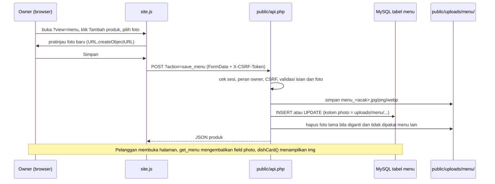

# Struktur Proyek Nusantara Bites

Dokumen ini disusun dari isi folder proyek yang sebenarnya, bukan struktur Laravel generik.

## Gambaran besar

Proyek ini **Laravel 13 (PHP 8.3, Vite, Tailwind 4) yang hanya dipakai sebagai cangkang halaman**. Seluruh logika
pemesanan, login staf, stok, dan manajemen menu ada di satu file PHP biasa, `public/api.php`, yang dipanggil browser
langsung dan **tidak melewati routing, controller, model, middleware, maupun session Laravel**.

Dampaknya untuk pengembangan:

- Mengubah tampilan atau interaksi: edit `resources/` (Blade, CSS, JS), lalu `npm run build`.
- Mengubah logika bisnis atau database: edit `public/api.php` dan file SQL di `database/sql/`.
- Koneksi database `api.php` ditulis langsung di bagian atas file (`$dbHost`, `$dbName`, `$dbUser`, `$dbPass`),
  **bukan dibaca dari `.env`**. Ubah di sana bila konfigurasi MySQL berbeda.
- Tabel aplikasi (`menu`, `orders`, `counters`, `users` staf, `stock_movements`, `audit_log`) dibuat dari file SQL,
  bukan dari migrasi Laravel. Jangan jalankan `php artisan migrate` pada database yang sama tanpa membaca bagian
  "Database" di bawah.

## Folder dan file

| Lokasi | Fungsi |
|---|---|
| `routes/web.php` | Satu route: `/` (bernama `home`) yang menampilkan view `home`. Semua layar (pelanggan, status pesanan, staf) dipilih oleh JS lewat parameter `?view=`. |
| `routes/console.php` | Bawaan Laravel, tidak berisi route khusus proyek. |
| `app/Http/Controllers/NusantaraBitesController.php` | **Kosong** (kelas tanpa method). Belum dipakai. `Controller.php` adalah kelas dasar bawaan. |
| `app/Models/User.php` | Model bawaan Laravel. **Tidak dipakai** sistem login staf; tabel `users` staf punya kolom berbeda (lihat Database). |
| `app/Console/Commands/CreateStaffUser.php` | Perintah `php artisan staff:create {username} {role}`: membuat atau memperbarui akun staf (owner, kasir, dapur) di tabel `users`. Kata sandi diminta lewat prompt (minimal 10 karakter). |
| `app/Providers/AppServiceProvider.php`, `bootstrap/`, `config/` | Konfigurasi bawaan Laravel. `config/restaurant.php` menyimpan nama restoran serta alamat, jam buka, dan telepon (dari `.env`: `RESTO_ADDRESS`, `RESTO_HOURS`, `RESTO_PHONE`) untuk footer. |
| `resources/views/home.blade.php` | **Halaman utama.** Bukan hanya landing page: berisi cangkang landing pelanggan (`#customer-shell`) dan wadah `#root` untuk layar status pesanan dan semua halaman staf. Layar awal dipilih server dari `?view=` agar tidak berkedip. |
| `resources/views/layouts/app.blade.php` | Kerangka HTML: font, `@vite(...)`, judul. |
| `resources/views/customer/` | Partial landing: `nav`, `hero`, `how` (cara memesan), `footer`. Daftar menu dan keranjang diisi JS. |
| `resources/views/components/` | **Tidak ada.** |
| `resources/css/site.css` | Entry CSS: mengimpor `base.css` (token warna, tombol), `customer.css` (landing, menu, keranjang, tiket status), `staff.css` (dapur, kasir, tabel, form, foto produk). |
| `resources/css/app.css`, `resources/js/app.js` | Bawaan skeleton Laravel (Tailwind). Tidak dipakai halaman Nusantara Bites. |
| `resources/js/site.js` | **Seluruh frontend**: state, pemanggilan API, tampilan pelanggan, keranjang, checkout, status pesanan, dan semua halaman staf. |
| `vite.config.js` | Membangun `site.css`, `site.js`, serta file bawaan. |
| `public/api.php` | **Backend sebenarnya**: autentikasi, peran, pesanan, stok, riwayat, keuangan, dan manajemen menu beserta foto. |
| `public/uploads/menu/` | Tempat foto produk hasil unggahan. Berisi `.htaccess` yang melarang eksekusi skrip. Isinya diabaikan git. |
| `public/images/menu/` | Cadangan lama: foto bernama `{id menu}.jpg` dipakai bila produk belum punya foto unggahan. |
| `public/index.php`, `public/.htaccess` | Pintu masuk Laravel. |
| `public/build/` | Hasil `npm run build` (dibuat otomatis, tidak masuk git). |
| `storage/app/public/` | Disediakan Laravel untuk file publik, **belum dipakai**. `public/storage` (hasil `storage:link`) tidak ada. |
| `database/sql/database.sql`, `migration_001.sql`, `migration_002.sql` | Skema sebenarnya. Urutan: `database.sql` lalu `migration_001.sql` lalu `migration_002.sql`. |
| `database/migrations/` | Tiga migrasi bawaan Laravel (users, cache, jobs). **Bukan** skema aplikasi. |
| `database/seeders/DatabaseSeeder.php`, `database/factories/` | Bawaan Laravel. Data menu awal ada di `database/sql/database.sql`. |
| `.env` | Konfigurasi lokal Laravel (nama aplikasi, koneksi database Laravel, mode debug). Berisi rahasia, jangan dibagikan atau di-commit. Catatan: `public/api.php` tidak membacanya. |
| `artisan`, `composer.json` | `artisan` adalah perintah CLI Laravel. `composer.json` mendaftar paket PHP (Laravel 13, PHP ^8.3). `package.json` mendaftar paket JS (Vite, Tailwind). |
| `tests/` | Hanya dua tes contoh bawaan. Belum ada tes untuk fitur proyek. |
| `CLAUDE.md`, `AGENTS.md` | Catatan bawaan skeleton untuk alat bantu AI. Bukan bagian aplikasi. |

## Database

Tabel dari file SQL: `menu` (id, cat, emoji, name, description, price, was, stock, is_active, sort_order, **photo**),
`orders`, `counters`, `users` (username, password_hash, role, is_active), `stock_movements`, `audit_log`.

Tabel `users` milik sistem ini **bentrok dengan `users` bawaan Laravel** (kolom `name`, `email`, `password`).
Selama belum ada migrasi Laravel yang menyatukan keduanya, jangan jalankan `php artisan migrate` ke database ini.

## Alur: owner menambah produk beserta foto

1. **Form tambah produk**: tidak ada file Blade. Form dibuat JS, fungsi `menuForm()` di `resources/js/site.js`,
   ditampilkan dalam `#root` pada `home.blade.php` saat URL `/?view=menu`.
2. **Route**: halamannya `/` (`routes/web.php`). Unggahannya dikirim ke `public/api.php?action=save_menu`,
   yang **bukan route Laravel** melainkan file yang dilayani langsung oleh web server.
3. **Controller**: tidak ada. Validasi dan pemrosesan ada di `case 'save_menu'` dan fungsi `storeMenuPhoto()` dalam
   `public/api.php`.
4. **Penyimpanan data**: query PDO `INSERT`/`UPDATE` di `api.php` dalam satu transaksi. Bukan Eloquent.
5. **Tabel**: `menu`, kolom `photo` berisi path relatif seperti `uploads/menu/menu_ab12....png`.
6. **File gambar**: `public/uploads/menu/`, dengan nama acak yang dibuat server dan ekstensi dari isi file.
7. **Halaman pelanggan**: fungsi `dishCard()` di `site.js` membuat tag `` (bukan Blade).
8. **URL foto**: `get_menu` mengembalikan `photo`, lalu `photoUrl(item)` membentuk `/uploads/menu/...`.
   Bila foto tidak ada atau gagal dimuat, tag `` dibuang dan placeholder piring yang tampil.

## Indeks lokasi fitur

| Fitur | File tampilan | Controller | Route / endpoint | Model / tabel |
|---|---|---|---|---|
| Halaman pelanggan | `home.blade.php`, `customer/*.blade.php`, `site.js` | Belum tersedia | `GET /` | Belum tersedia |
| Daftar menu | `site.js` (`menuRegionHtml`, `dishCard`) | `public/api.php` | `api.php?action=get_menu` | tabel `menu` |
| Tambah produk | `site.js` (`menuForm`, `viewMenuAdmin`), `/?view=menu` | `public/api.php` (`save_menu`) | `api.php?action=save_menu` | tabel `menu` |
| Edit produk | sama dengan tambah produk (tombol Edit) | `public/api.php` (`save_menu`, `list_menu_admin`) | `api.php?action=save_menu` | tabel `menu` |
| Upload foto | `site.js` (`previewPhoto`, `saveMenu`) | `public/api.php` (`storeMenuPhoto`) | `api.php?action=save_menu` | `menu.photo`, folder `public/uploads/menu/` |
| Keranjang dan checkout | `site.js` (`cartRegionHtml`, `submitOrder`) | `public/api.php` | `api.php?action=create_order` | `orders`, `counters`, `menu`, `stock_movements` |
| Status pesanan pelanggan | `site.js` (`viewStatus`) | `public/api.php` | `api.php?action=get_order` | `orders` |
| Login staf | `site.js` (`viewLogin`), `/?view=login` | `public/api.php` | `api.php?action=login`, `me`, `logout` | `users`, `audit_log` |
| Dashboard owner | `site.js` (hub `viewStaffHub`, `viewMenuAdmin`, `viewHistory`, `viewStock`, `viewFinance`) | `public/api.php` | `list_menu_admin`, `list_transactions`, `set_stock`, `stock_movements`, `finance_summary` | `menu`, `orders`, `stock_movements` |
| Dashboard kasir | `site.js` (`viewCashier`), `/?view=kasir` | `public/api.php` | `get_orders`, `admin_search`, `set_payment`, `cancel_order` | `orders`, `audit_log` |
| Dashboard dapur | `site.js` (`viewKitchen`), `/?view=dapur` | `public/api.php` | `get_orders`, `advance_order` | `orders` |
| Layar antrean | `site.js` (`viewDisplay`), `/?view=display` | `public/api.php` | `get_ready_queue` | `orders` |
| Bahan baku, resep, pembelian, pengeluaran, laba | Belum tersedia | Belum tersedia | Belum tersedia | Belum tersedia |
| Manajemen akun staf (antarmuka) | Belum tersedia | `app/Console/Commands/CreateStaffUser.php` (CLI) | `php artisan staff:create` | `users` |

## Catatan yang perlu diketahui

- Akses per peran ditegakkan di `public/api.php` (konstanta `ACCESS`). Daftar menu per peran di `site.js`
  (`ROLE_VIEWS`) hanya menyembunyikan tautan.
- Produk tidak dihapus permanen: pesanan dan riwayat stok merujuk ke id menu. Untuk menyembunyikan produk,
  hilangkan centang "Tampil di menu pelanggan".
- Menambah halaman atau endpoint baru: tambahkan `case` di `api.php` (dan peran di `ACCESS`), lalu fungsi tampilan dan
  entri di `VIEW_RENDERERS`, `VIEWS`, dan `STAFF_VIEWS` pada `site.js`, serta daftar `$staffViews` di `home.blade.php`.
